# Collateral Annotator

**English** · [中文](README.zh-CN.md)

> [!CAUTION]
> **One tab per computer. Annotating together in a shared folder has not been tested.**
>
> - On each computer, open the annotator in **one tab of one browser**. A second tab in the same browser is stopped with a notice; another browser or a private window is not detected.
> - Working in the **same data folder** from several computers or by several people — for example a folder shared through Google Drive, Dropbox or OneDrive — **has not been tested**.
> - To avoid conflicts, **split the work before you start**: prepare the data folder once and create the classes, then give everyone a copy and their own cases (for example `s_0`–`s_9`, `s_10`–`s_19`, …). Each person annotates only their own cases, on their own computer, and leaves the classes as they are, so that a class number means the same in every copy. At the end, copy the finished case folders back into one data folder.

Mark collateral vessel segments on DSA frames, right in the browser. Your files stay on your computer.

**▶ [Open the annotator](https://jctaylor666.github.io/collateral-annotator/)** · **[Prepare data from DICOM](https://jctaylor666.github.io/collateral-annotator/prepare.html)**

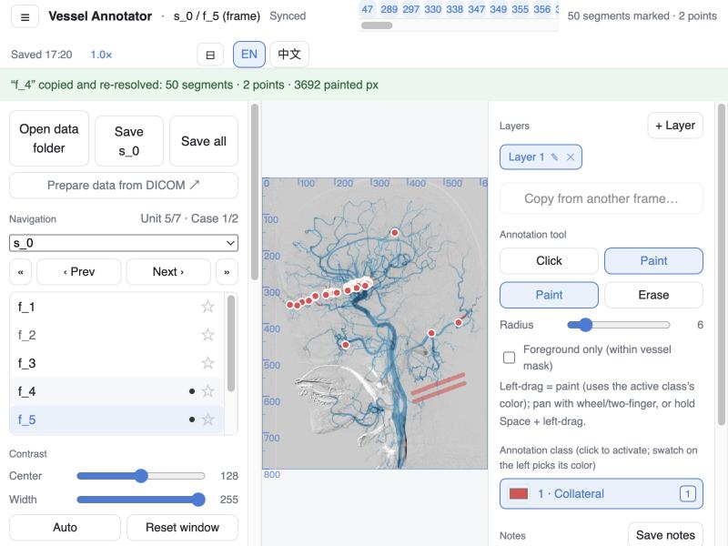

> Use **Chrome or Edge** on a computer. Other browsers can show the page but cannot open a folder.

---

## 1 · Prepare data from DICOM


1. **Open folder…** — every DICOM file in the folder (subfolders included) becomes one case, `s_0, s_1, …`.
2. **Prepare dataset** — frames are converted, black borders removed, vessels segmented and split into clickable segments.
3. Open the new `annotator_dataset_<date>-<time>` folder in the annotator.

`case_mapping.csv` in that folder says which DICOM each case came from. The first run downloads the vessel model (about 0.9 GB); after that it is cached.
Leave the new folder where it is until the run has finished: if it is moved, renamed or replaced while the run is working, the run stops and says so (what it had written stays in the folder the run started in; the unit being written at that moment may be incomplete there).

## 2 · Open a data folder

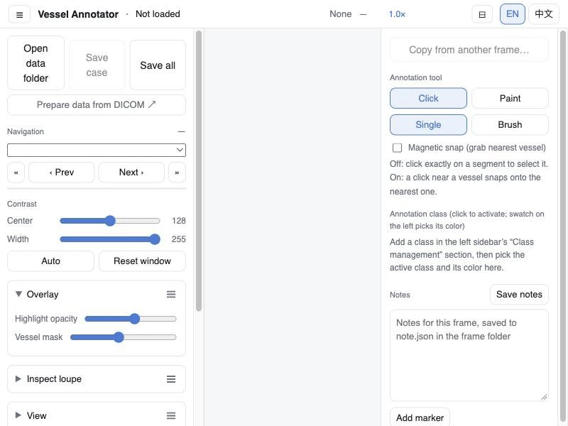

**Open data folder** → choose a case in the drop-down → click a frame, or use **← / →**.
A dot next to a frame means it has annotations; **☆** flags a frame.

## 3 · Annotate

### Classes

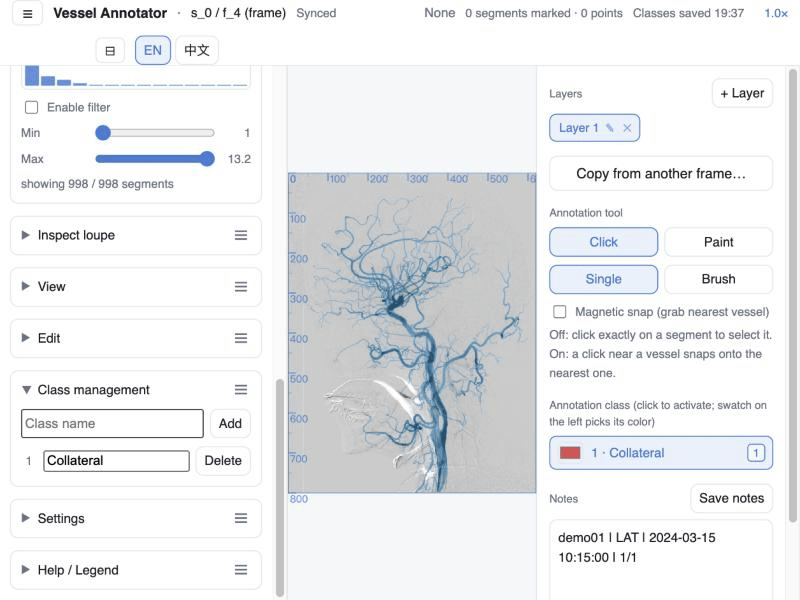

- **Class management** (left sidebar): type a name → **Add**. Classes are numbered 1, 2, 3 … Edit a name to rename it. **Delete** only works while no frame uses that class.
- **Annotation class** (right panel): click a class, or press its number **1–9**, to make it active. The colour square sets its colour.
- Class names are saved in `classes.json` in the data folder; colours stay in your browser.

### Tools

Choose a tool in the right panel. Every mark gets the active class.

| tool | key | use it to |
|---|---|---|
| **Click › Single** | **C** | mark one segment per click |
| **Click › Brush** | **B** | mark or unmark every segment along a stroke |
| **Paint** | **P** | paint pixels by hand, regardless of segments |

#### Click › Single

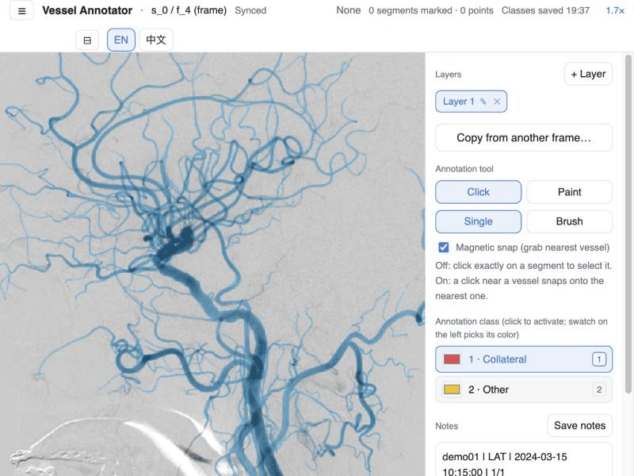

- Click a segment to mark it; click it again to unmark it. A segment with another class switches to the active one.
- Each marked segment keeps a red point where you clicked. A click on background leaves just a red point; click the point again to remove it.
- **Magnetic snap** on: a click near a vessel grabs the nearest segment. Off: you have to hit the segment itself.

#### Click › Brush

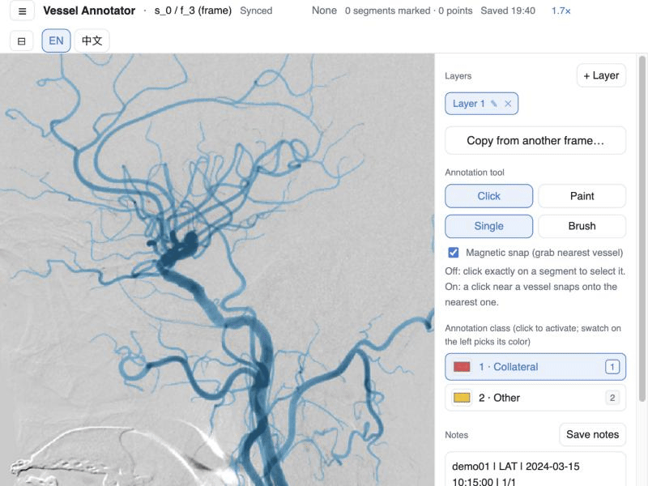

- **Select**: drag; every segment the circle touches is marked.
- **Deselect**: drag; every segment the circle touches is unmarked, red points included.
- **Radius** sets the circle size.

#### Paint

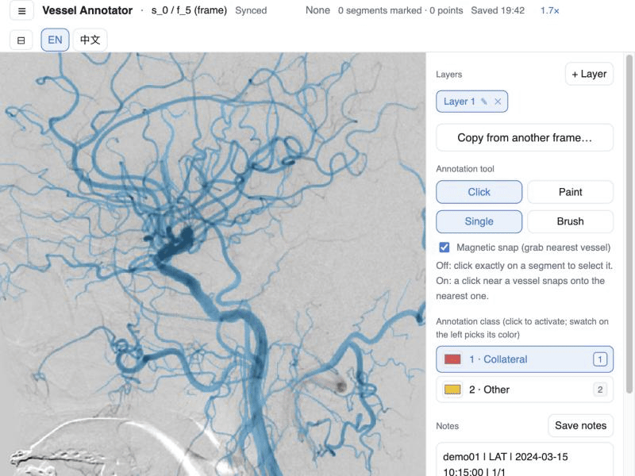

- **Paint**: drag to colour pixels. **Erase** removes paint.
- **Foreground only**: paint lands only on the vessel mask. A frame without a readable `mask.npy` has no mask to limit the brush: there paint lands wherever you drag.
- **Radius** sets the brush size. Marking a segment clears any paint on it.

With Brush or Paint, hold **Space** while dragging to pan.

### Layers

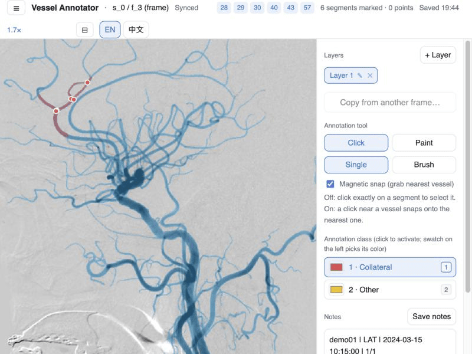

**+ Layer** (top of the right panel) adds an empty layer: a separate set of marks on the same frame. Click a layer's name to switch to it; **✎** renames it, **✕** deletes it.

## 4 · Helpers

**Segment filter** — in the **Segment geometry** panel (left sidebar), pick a metric (radius, length, area, width, tortuosity), tick **Enable filter** and drag **Min / Max**. Hidden segments can't be marked.

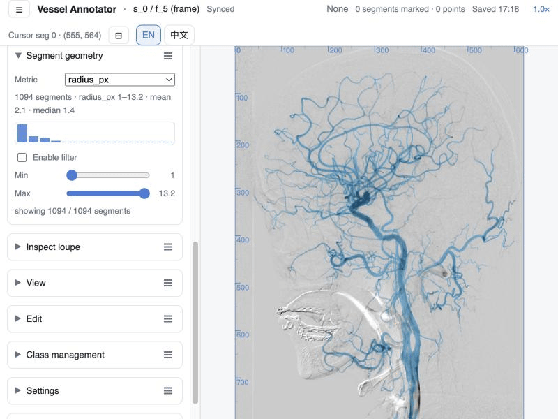

**Inspect loupe** — hold **Cmd / Ctrl** over the image: the same spot in every frame, the MinIP and the perfusion map. The **Inspect loupe** panel sets the zoom, the number of neighbour frames, the view size and a 3×3 mean, and can pin the MinIP or the perfusion map.

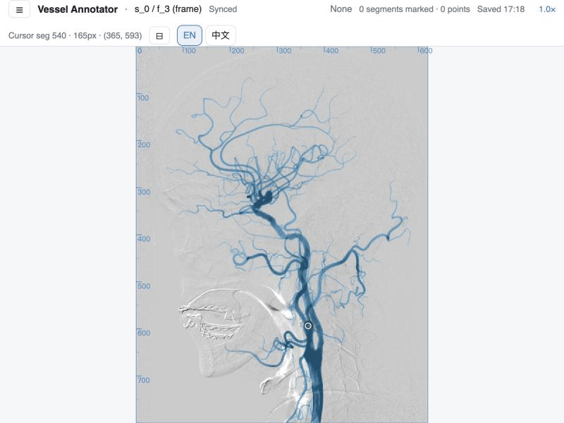

**Copy from another frame** — on a frame with no marks and no numbered markers yet (a note or a star does not matter), click **Copy from another frame…**, then the source frame in the list (**Esc** cancels). Marks are matched to this frame's own segments; all layers are copied.

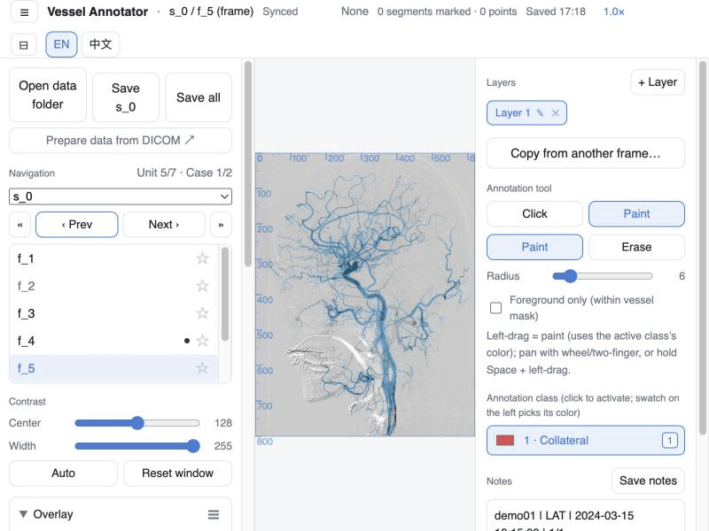

**Notes and markers** — type in **Notes**; click **Add marker**, then the image, to place a numbered marker. Both are saved to `note.json`.


**Perfusion** — the last unit of every case colours each vessel by when the contrast arrives. **Export perfusion map** (Inspect loupe panel) saves it as a PNG.

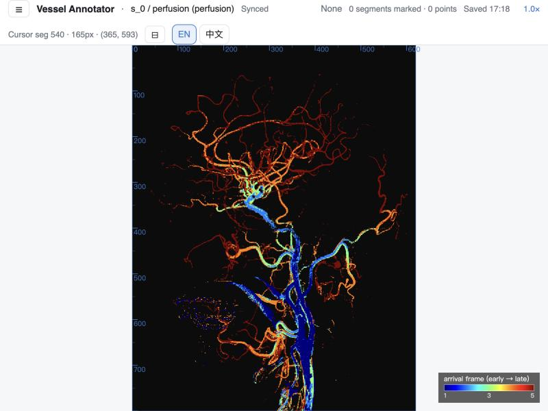

## 5 · Saving

- Changes are saved automatically about 1 s later. **Save s_N** writes the current case, **Save all** the whole dataset.
- Everything is written into the data folder, next to the images:

  | file | contents |
  |---|---|
  | `annotation.json` | marked segments, points, paint, star |
  | `note.json` | note text and markers |
  | `classes.json` | class names (colours stay in your browser) |

- If a frame's file was changed elsewhere (another computer, a colleague, another program) since this browser last read or saved it, it is not overwritten: you choose which version to keep, and the other one is kept as a backup file. Only one tab of a browser works at a time: a second tab shows a notice and starts by itself once the first is closed. What the app cannot see is a change that reaches the folder in the moment between its last look at a file and its own write — from another computer, another browser or program, or a sync that is still on its way; there the later save replaces the earlier one. So two people should not annotate the same frame at the same time.

## 6 · Other panels

| panel (left sidebar) | what it does |
|---|---|
| **Contrast** | **Center / Width** set brightness and contrast on screen; **Auto** fits them to the image. Image files are not changed. |
| **Overlay** | Opacity of the marked segments and of the vessel mask. |
| **View** | **Reset view** fits the image to the window. |
| **Edit** | **Undo**. **Clear this unit** removes the current layer's marks on this frame; notes, markers and the star stay. |
| **Settings** | **Coordinate order**: x,y or y,x in the saved files. **Auto-save** on or off. **Reset panel order**. |
| **Help / Legend** | Colour legend and the full **Data format…** page. |

A panel with **▶** before its title folds when you click the title, and its **≡** handle drags it to another place (remembered in this browser); Contrast is always open. **\\** hides the left sidebar; **⊟** in the top bar hides the right panel.

## Keyboard

| key | action |
|---|---|
| **← / →** | previous / next frame |
| **1 – 9** | active class |
| **C / B / P** | click / brush / paint |
| hold **Cmd / Ctrl** | inspect loupe |
| **Cmd / Ctrl + Z** | undo |
| wheel, pinch | zoom |
| drag (or **Space** + drag) | pan |
| **\\** | show / hide the left sidebar |
| **Esc** | cancel |

## Data folder layout

```
<data folder>/
├─ classes.json
├─ s_0/                   one case
│  ├─ f_1/                one frame
│  │  ├─ frames.png       image, 8-bit grayscale         required
│  │  ├─ label.npy        segment id per pixel (uint16)   required
│  │  ├─ mask.npy         vessel mask 0/1 (uint8)         optional
│  │  ├─ geometry.json    per-segment metrics            optional
│  │  └─ annotation.json, note.json      written by the annotator
│  └─ minip/              minimum-intensity projection, listed last
└─ s_1/ …
```

- A case or frame folder is recognised by the number in its name: all digits (`7`), ending in `_<number>` (`s_0`, `case_12`) or starting with `<number>_` (`12_patient`). Other names, such as `case3`, are skipped. The one exception is a frame folder named exactly `minip`, which is loaded too.
- `frames.png`, `label.npy` and `mask.npy` of a frame must have the same size.

Full specification (it also works as a prompt for an AI agent): **[docs/data-format.md](docs/data-format.md)**. The app has its own copy under **Help / Legend → Data format…**.
