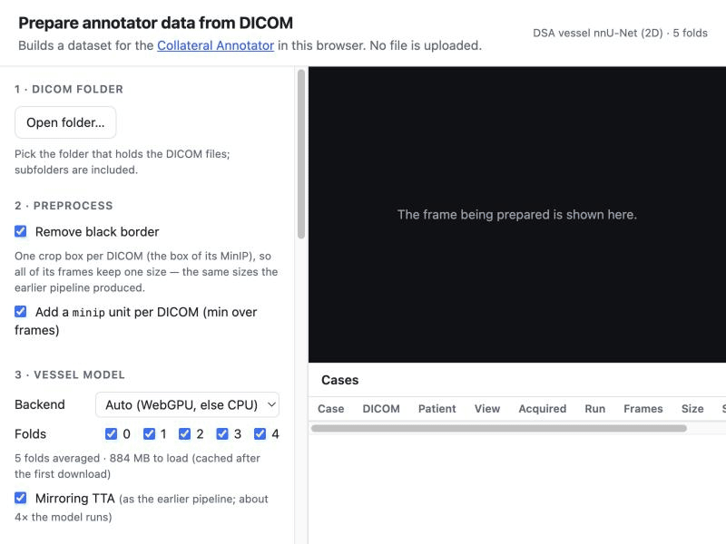
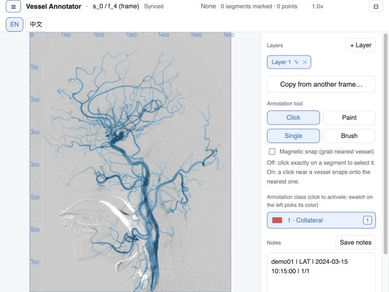
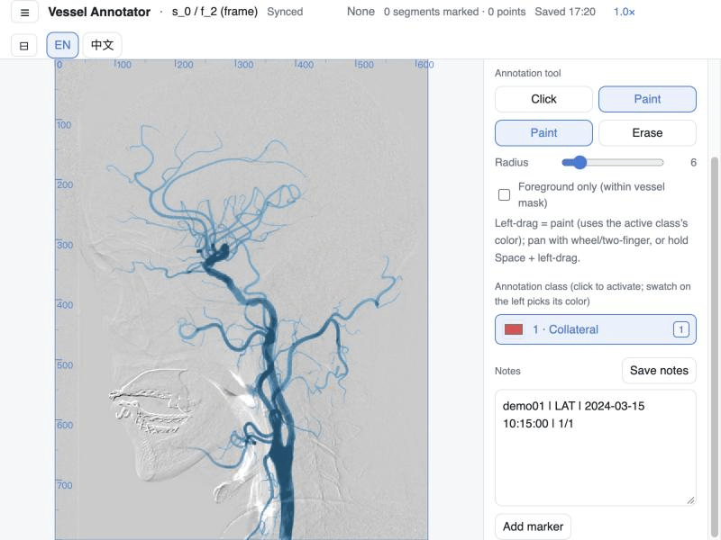

# Collateral Annotator

**English** · [中文](README.zh-CN.md)

Mark collateral vessel segments on DSA frames, right in the browser. Your files stay on your computer.

**▶ [Open the annotator](https://jctaylor666.github.io/collateral-annotator/)** · **[Prepare data from DICOM](https://jctaylor666.github.io/collateral-annotator/prepare.html)**


> Use **Chrome or Edge** on a computer. Other browsers can show the page but cannot open a folder.

---

## 1 · Prepare data from DICOM



1. **Open folder…** — every DICOM file in the folder (subfolders included) becomes one case, `s_0, s_1, …`.
2. **Prepare dataset** — frames are converted, black borders removed, vessels segmented and split into clickable segments.
3. Open the new `annotator_dataset_<date>-<time>` folder in the annotator.

`case_mapping.csv` in that folder says which DICOM each case came from. The first run downloads the vessel model (about 0.9 GB); after that it is cached.

## 2 · Open a data folder


**Open data folder** → choose a case in the drop-down → click a frame, or use **← / →**.
A dot next to a frame means it has annotations; **☆** flags a frame.

## 3 · Annotate



- **Click a vessel** to mark its segment in the active class. Click it again to remove it.
- **Magnetic snap** grabs the nearest vessel, so you don't have to hit it exactly.
- A click on background drops a red point.


- **Brush** — drag to mark every segment you cross.
- **Paint** — paint free-form regions (optionally only on the vessel mask). **Erase** removes paint.

Classes are added in **Class management** (left sidebar); keys **1–9** pick the active class. **+ Layer** keeps a separate set of marks on the same frame.

## 4 · Helpers

**Segment filter** — show only segments in a radius (or length, area …) range.


**Inspect loupe** — hold **Cmd / Ctrl** over the image: the same spot in every frame, the MinIP and the perfusion map.


**Copy from another frame** — on a frame with no marks yet, reuse a neighbour's marks (matched to this frame's own segments).


**Notes and markers** — free text and numbered markers for each frame.



**Perfusion** — the last unit of every case colours each vessel by when the contrast arrives.


## 5 · Saving

- Changes are saved automatically about 1 s later. **Save s_N** writes the current case, **Save all** the whole dataset.
- Everything is written into the data folder, next to the images:

  | file | contents |
  |---|---|
  | `annotation.json` | marked segments, points, paint, star |
  | `note.json` | note text and markers |
  | `classes.json` | class names (colours stay in your browser) |

- If a file was changed elsewhere (another computer, a colleague), nothing is overwritten: you choose which version to keep, and the other one is kept as a backup.

## Keyboard

| key | action |
|---|---|
| **← / →** | previous / next frame |
| **1 – 9** | active class |
| **C / B / P** | click / brush / paint |
| hold **Cmd / Ctrl** | inspect loupe |
| **Cmd / Ctrl + Z** | undo |
| wheel, pinch | zoom |
| drag (or **Space** + drag) | pan |
| **\\** | show / hide the left sidebar |
| **Esc** | cancel |

## Data folder layout

```
<data folder>/
├─ classes.json
├─ s_0/                   one case
│  ├─ f_1/                one frame
│  │  ├─ frames.png       image, 8-bit grayscale         required
│  │  ├─ label.npy        segment id per pixel (uint16)   required
│  │  ├─ mask.npy         vessel mask 0/1 (uint8)         optional
│  │  ├─ geometry.json    per-segment metrics            optional
│  │  └─ annotation.json, note.json      written by the annotator
│  └─ minip/              minimum-intensity projection, listed last
└─ s_1/ …
```

- Folder names must contain a number (`s_0`, `case_12`, `7`); other folders are skipped.
- `frames.png`, `label.npy` and `mask.npy` of a frame must have the same size.

Full specification (it also works as a prompt for an AI agent): **[docs/data-format.md](docs/data-format.md)**. The same text is in the app under **Help / Legend → Data format…**.
