# 侧支标注器

[English](README.md) · **中文**

> [!CAUTION]
> **每台电脑只开一个标签页；多人共用一个文件夹协同标注，没有测试过。**
>
> - 每台电脑只在**一个浏览器的一个标签页**里打开标注工具。同一个浏览器里再开的标签页会被拦下并显示提示；换一个浏览器或用无痕窗口打开，则检测不到。
> - 多人或多台电脑在**同一个数据文件夹**里标注（比如通过 Google Drive、Dropbox、OneDrive 共享的文件夹），**没有测试过**。
> - 为避免冲突，请**开始前先分好工**：数据文件夹只准备一次，先建好类别，再给每人一份拷贝，并分好各自的 case（比如 `s_0`–`s_9`、`s_10`–`s_19`……）。每人只在自己的电脑上标自己的 case，不要改动类别，这样同一个类别编号在每一份里都指同一类。全部标完后，把各自完成的 case 文件夹拷回同一个数据文件夹。

在浏览器里给 DSA 帧标注侧支血管段。文件始终留在你自己的电脑上。

**▶ [打开标注工具](https://jctaylor666.github.io/collateral-annotator/)** · **[从 DICOM 准备数据](https://jctaylor666.github.io/collateral-annotator/prepare.html)**


> 请在电脑上用 **Chrome 或 Edge**。其他浏览器能打开页面，但不能打开文件夹。
>
> 动图里是英文界面；标注工具右上角的 **EN / 中文** 可以切换语言。

---

## 1 · 从 DICOM 准备数据

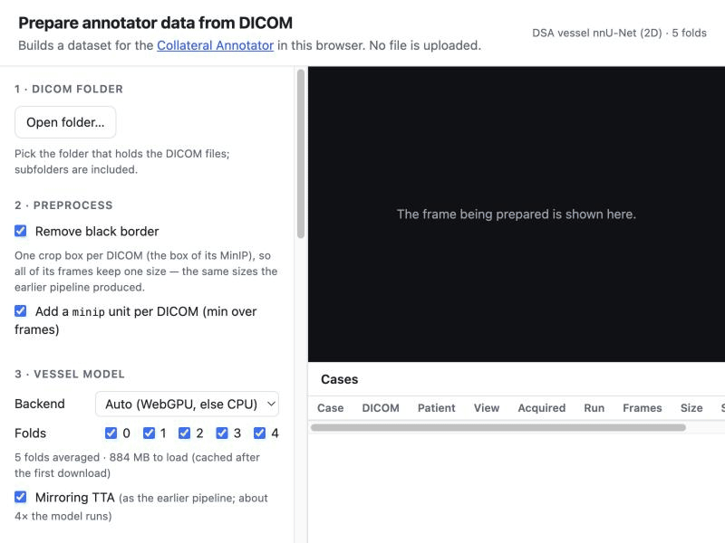

1. **Open folder…**：文件夹（含子文件夹）里的每个 DICOM 文件成为一个 case：`s_0, s_1, …`。
2. **Prepare dataset**：自动转换帧、去黑边、分割血管，并把血管切成可以点选的段。
3. 用标注工具打开新生成的 `annotator_dataset_<日期>-<时间>` 文件夹。

文件夹里的 `case_mapping.csv` 记录每个 case 来自哪个 DICOM。第一次运行会下载血管模型（约 0.9 GB），之后从浏览器缓存读取。
运行结束前请不要移动、改名或替换新生成的文件夹：否则运行会停下并给出提示（已经写出的内容留在运行开始时的那个文件夹里，当时正在写的那个单元可能不完整）。

## 2 · 打开数据文件夹

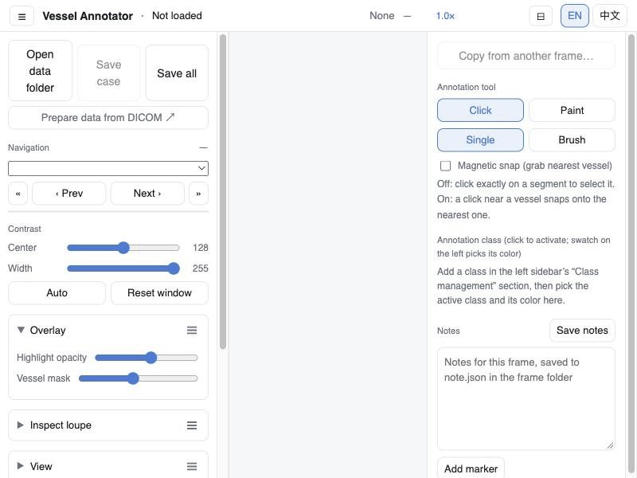

**打开数据文件夹** → 在下拉框里选 case → 点一帧，或用 **← / →** 切换。
帧旁边的圆点表示这一帧有标注；**☆** 用来给帧加星。

## 3 · 标注

### 类别

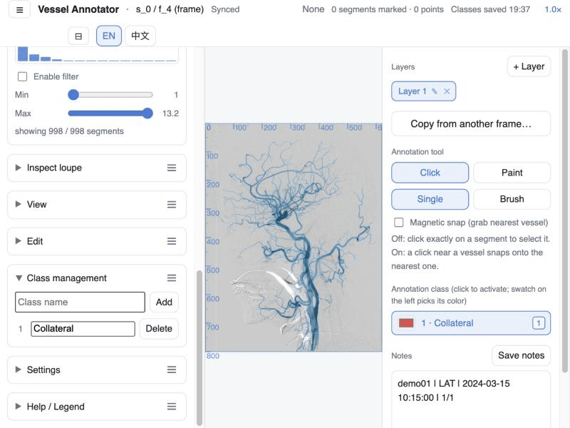

- **分类管理**（左侧栏）：输入名称 → **添加**。类别按 1、2、3 … 编号。直接修改名称即可改名；只有没有任何帧用到某个类别时，**删除** 才有效。
- **标注分类**（右侧栏）：点一个类别，或按它的数字 **1–9**，设为当前类别；左边的色块用来选颜色。
- 类别名称保存在数据文件夹的 `classes.json` 里；颜色只存在你的浏览器里。

### 工具

在右侧栏选择工具。所有标注都使用当前类别。

| 工具 | 按键 | 用途 |
|---|---|---|
| **点选 › 单点** | **C** | 一次点一个段 |
| **点选 › 笔刷** | **B** | 一笔标记或取消经过的所有段 |
| **涂抹** | **P** | 按像素自由涂抹，不受分段限制 |

#### 点选 › 单点

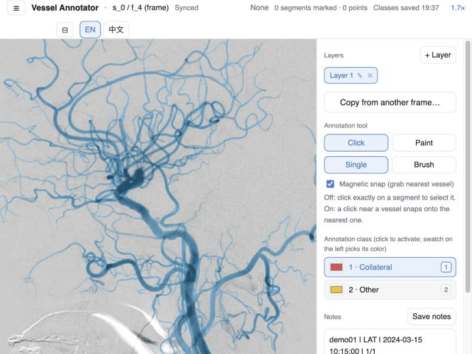

- 点一个段即标记；再点一次取消。如果它属于别的类别，会改成当前类别。
- 每个标记的段都会在点击处留一个红点。点在背景上只留一个红点，再点这个红点即删除。
- **磁性吸附** 打开：点在血管附近会吸到最近的段；关闭：必须正好点在段上。

#### 点选 › 笔刷

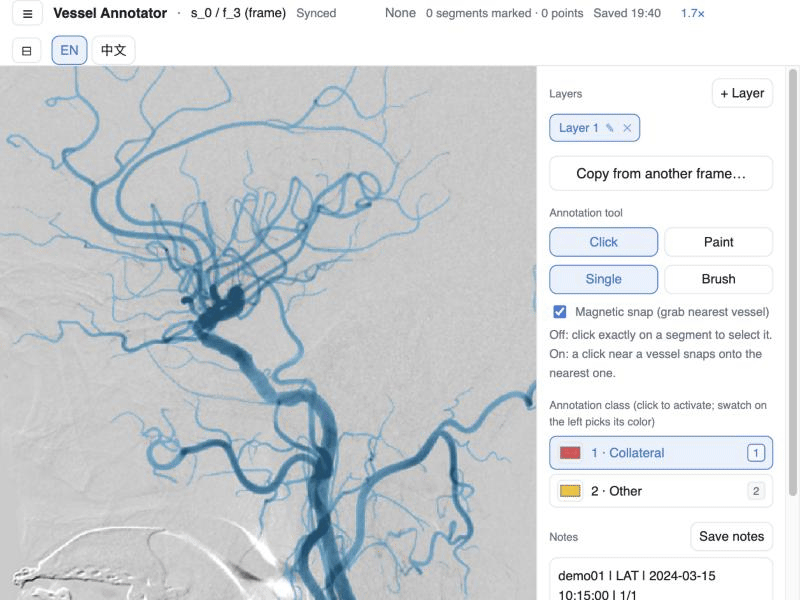

- **选中**：拖动，圆圈碰到的段都会被标记。
- **取消**：拖动，圆圈碰到的段都会被取消，红点也一并删除。
- **半径** 调整圆圈大小。

#### 涂抹

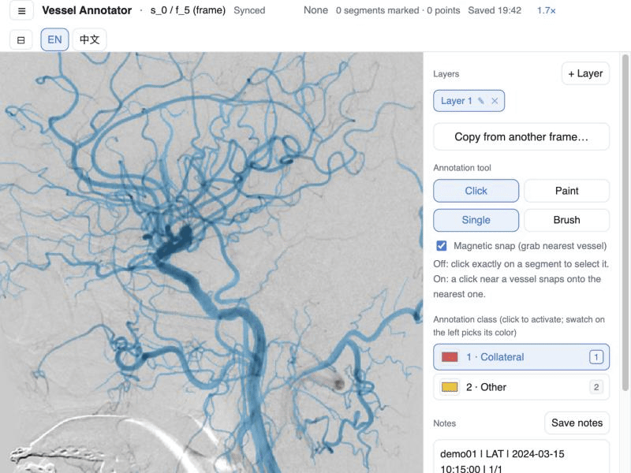

- **涂抹**：拖动给像素上色；**擦除** 去掉涂抹。
- **仅前景**：只涂在血管 mask 上。没有可读 `mask.npy` 的帧没有 mask 可以限制笔刷：这时拖到哪里就涂到哪里。
- **半径** 调整笔刷大小。标记一个段时，会清除这个段上的涂抹。

使用笔刷或涂抹时，按住 **空格** 再拖动即为平移。

### 图层

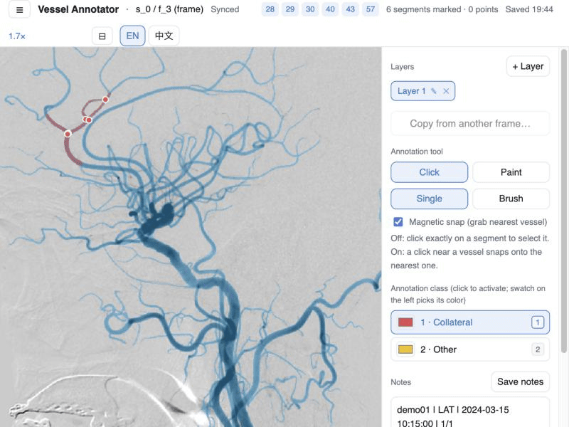

右侧栏顶部的 **+ 图层** 新建一个空图层：同一帧上另一套独立的标注。点图层名称切换；**✎** 改名，**✕** 删除。

## 4 · 辅助功能

**段过滤**：在左侧栏的 **分区几何** 面板里选参数（半径、长度、面积、宽度、弯曲度），勾选 **启用过滤**，拖动 **最小 / 最大**。被隐藏的段不能标注。

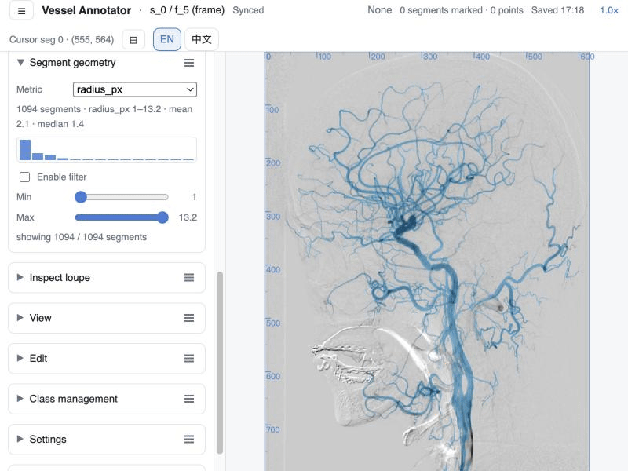

**检视放大镜**：在图上按住 **Cmd / Ctrl**，同一位置在每一帧、MinIP 和灌注图里的样子都会显示出来。**检视放大镜** 面板可以调放大率、前后帧数、视野大小和 3×3 均值，也可以固定显示 MinIP 或灌注图。

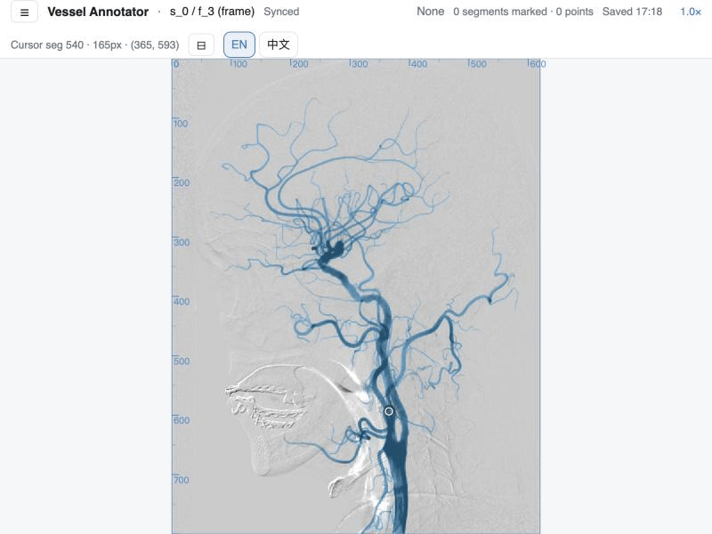

**从其他帧复制**：在还没有标注、也没有编号标记的帧上（有笔记或星标不影响），点 **从其他帧复制…**，再在帧列表里点来源帧（**Esc** 取消）。标注会按本帧自己的分段重新匹配，所有图层都会复制。

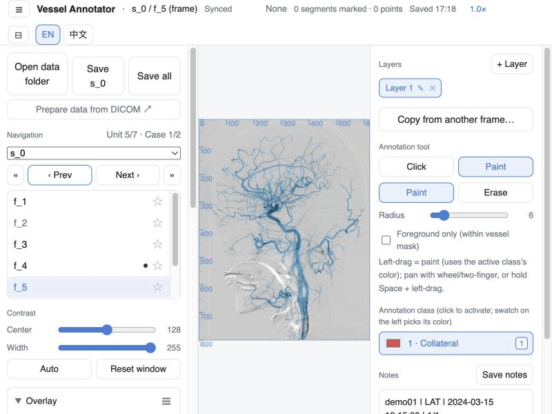

**笔记和标记**：在 **笔记** 里写文字；点 **添加标记**，再点图像，放一个编号标记。两者都保存在 `note.json`。

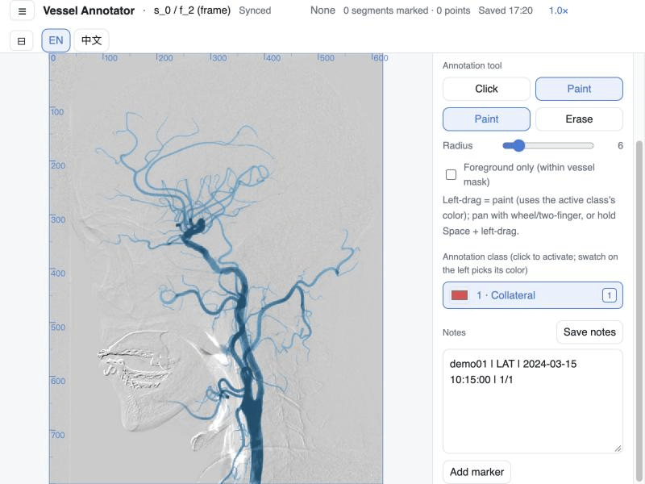

**灌注图**：每个 case 的最后一项，按造影剂到达的先后给血管上色。**导出灌注图**（检视放大镜面板）把它保存为 PNG。

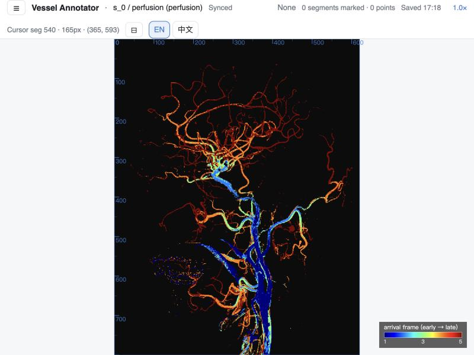

## 5 · 保存

- 改动大约 1 秒后自动保存。**保存 s_N** 保存当前 case，**全部保存** 保存整个数据集。
- 所有结果都写进数据文件夹，和图像放在一起：

  | 文件 | 内容 |
  |---|---|
  | `annotation.json` | 标记的段、红点、涂抹、星标 |
  | `note.json` | 笔记文字和编号标记 |
  | `classes.json` | 类别名称（颜色只存在你的浏览器里） |

- 如果某一帧的文件在本浏览器上次读取或保存之后在别处被改过（另一台电脑、同事、别的程序），它不会被覆盖：由你选择保留哪个版本，另一个会存成备份文件。同一个浏览器里同一时间只有一个标签页能工作：再开一个会显示提示，等先开的那个关闭后自动启动。程序看不出来的是：在它最后一次查看文件和自己写入之间的那一瞬间到达文件夹的改动——来自另一台电脑、另一个浏览器或程序，或者还在路上的同步；这时后保存的会替换先保存的。所以不要两个人同时标注同一帧。

## 6 · 其他面板

| 面板（左侧栏） | 作用 |
|---|---|
| **影像对比度** | **窗中心 / 窗宽** 调整屏幕上的亮度和对比度；**自动** 按图像自动设置。不会改动图像文件。 |
| **叠加层** | 已标记段和血管 mask 的透明度。 |
| **视图** | **复位视图**：让图像适应窗口。 |
| **编辑** | **撤销**。**清空本单元** 清除本帧当前图层的标注；笔记、标记和星标保留。 |
| **设置** | **坐标顺序**：保存的文件里坐标写成 x,y 还是 y,x。**自动保存** 开关。**恢复默认面板顺序**。 |
| **帮助 / 图例** | 颜色图例和完整的 **数据组织格式…** 说明。 |

标题前带 **▶** 的面板，点标题可以折叠，拖动标题右侧的 **≡** 可以调整顺序（只记在本浏览器里）；影像对比度始终展开。**\\** 隐藏左侧栏，顶栏的 **⊟** 隐藏右侧栏。

## 快捷键

| 按键 | 作用 |
|---|---|
| **← / →** | 上一帧 / 下一帧 |
| **1 – 9** | 切换当前类别 |
| **C / B / P** | 点选 / 笔刷 / 涂抹 |
| 按住 **Cmd / Ctrl** | 检视放大镜 |
| **Cmd / Ctrl + Z** | 撤销 |
| 滚轮、双指缩放 | 缩放 |
| 拖动（或 **空格** + 拖动） | 平移 |
| **\\** | 显示 / 隐藏左侧栏 |
| **Esc** | 取消 |

## 数据文件夹结构

```
<数据文件夹>/
├─ classes.json
├─ s_0/                   一个 case
│  ├─ f_1/                一帧
│  │  ├─ frames.png       图像,8-bit 灰度              必需
│  │  ├─ label.npy        每个像素的段编号(uint16)     必需
│  │  ├─ mask.npy         血管 mask 0/1(uint8)         可选
│  │  ├─ geometry.json    每段的几何指标                可选
│  │  └─ annotation.json, note.json     由标注工具写入
│  └─ minip/              最小强度投影,排在最后
└─ s_1/ …
```

- case 和帧的文件夹靠名字里的数字识别：纯数字（`7`）、以 `_<数字>` 结尾（`s_0`、`case_12`）或以 `<数字>_` 开头（`12_patient`）。其他名字（例如 `case3`）会被跳过。唯一的例外是名字正好是 `minip` 的帧文件夹，它也会被载入。
- 同一帧的 `frames.png`、`label.npy`、`mask.npy` 尺寸必须一致。

完整说明（也可以直接当作给 AI agent 的 prompt）：**[docs/data-format.zh-CN.md](docs/data-format.zh-CN.md)**。标注工具左侧栏 **帮助 / 图例 → 数据组织格式…** 里有应用自己的一份。
