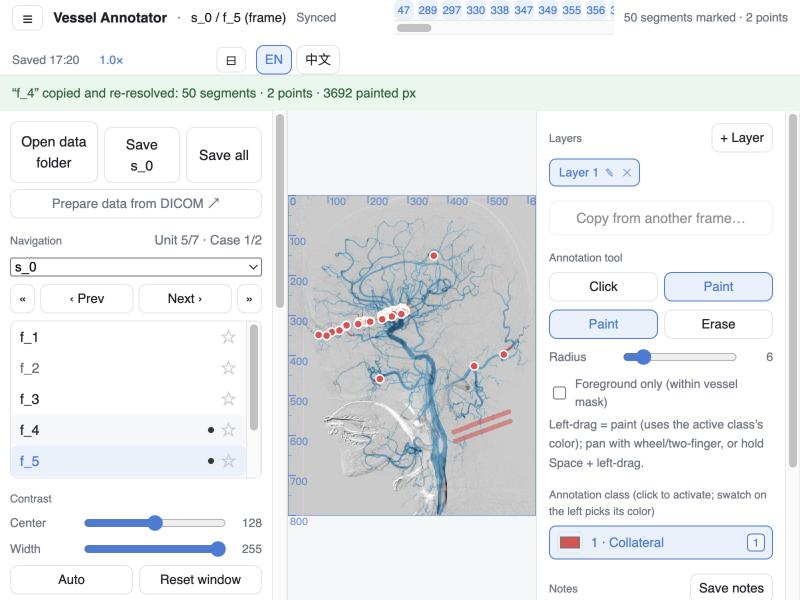
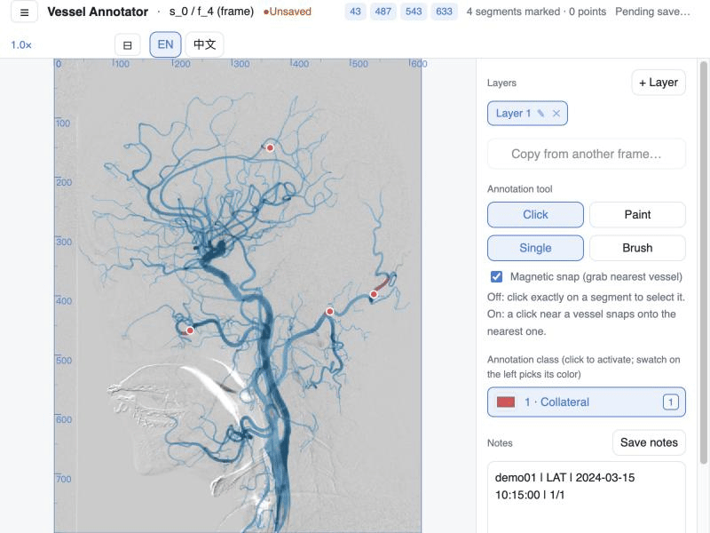

# 侧支标注器

[English](README.md) · **中文**

在浏览器里给 DSA 帧标注侧支血管段。文件始终留在你自己的电脑上。

**▶ [打开标注工具](https://jctaylor666.github.io/collateral-annotator/)** · **[从 DICOM 准备数据](https://jctaylor666.github.io/collateral-annotator/prepare.html)**



> 请在电脑上用 **Chrome 或 Edge**。其他浏览器能打开页面，但不能打开文件夹。
>
> 动图里是英文界面；标注工具右上角的 **EN / 中文** 可以切换语言。

---

## 1 · 从 DICOM 准备数据


1. **Open folder…**：文件夹（含子文件夹）里的每个 DICOM 文件成为一个 case：`s_0, s_1, …`。
2. **Prepare dataset**：自动转换帧、去黑边、分割血管，并把血管切成可以点选的段。
3. 用标注工具打开新生成的 `annotator_dataset_<日期>-<时间>` 文件夹。

文件夹里的 `case_mapping.csv` 记录每个 case 来自哪个 DICOM。第一次运行会下载血管模型（约 0.9 GB），之后从浏览器缓存读取。

## 2 · 打开数据文件夹


**打开数据文件夹** → 在下拉框里选 case → 点一帧，或用 **← / →** 切换。
帧旁边的圆点表示这一帧有标注；**☆** 用来给帧加星。

## 3 · 标注


- **点一下血管**：用当前类别标记这一段；再点一次取消。
- **磁性吸附**：自动吸到最近的血管，不用点得很准。
- 点在背景上会留下一个红点。



- **笔刷**：拖过去，经过的段全部标记。
- **涂抹**：自由涂抹区域（可只涂在血管上）；**擦除** 去掉涂抹。

类别在左侧栏的 **分类管理** 里添加；数字键 **1–9** 切换当前类别。**+ 图层** 可以在同一帧上另存一套标注。

## 4 · 辅助功能

**段过滤**：只显示半径（或长度、面积……）在某个范围内的段。


**检视放大镜**：在图上按住 **Cmd / Ctrl**，同一位置在每一帧、MinIP 和灌注图里的样子都会显示出来。


**从其他帧复制**：在还没有标注的帧上，复用相邻帧的标注（会按本帧自己的分段重新匹配）。


**笔记和标记**：每一帧都可以写文字笔记、放编号标记。


**灌注图**：每个 case 最后一项，按造影剂到达的先后给血管上色。


## 5 · 保存

- 改动大约 1 秒后自动保存。**保存 s_N** 保存当前 case，**全部保存** 保存整个数据集。
- 所有结果都写进数据文件夹，和图像放在一起：

  | 文件 | 内容 |
  |---|---|
  | `annotation.json` | 标记的段、红点、涂抹、星标 |
  | `note.json` | 笔记文字和编号标记 |
  | `classes.json` | 类别名称（颜色只存在你的浏览器里） |

- 如果文件在别处被改过（另一台电脑、同事），不会被覆盖：由你选择保留哪个版本，另一个会存成备份。

## 快捷键

| 按键 | 作用 |
|---|---|
| **← / →** | 上一帧 / 下一帧 |
| **1 – 9** | 切换当前类别 |
| **C / B / P** | 点选 / 笔刷 / 涂抹 |
| 按住 **Cmd / Ctrl** | 检视放大镜 |
| **Cmd / Ctrl + Z** | 撤销 |
| 滚轮、双指缩放 | 缩放 |
| 拖动（或 **空格** + 拖动） | 平移 |
| **\\** | 显示 / 隐藏左侧栏 |
| **Esc** | 取消 |

## 数据文件夹结构

```
<数据文件夹>/
├─ classes.json
├─ s_0/                   一个 case
│  ├─ f_1/                一帧
│  │  ├─ frames.png       图像,8-bit 灰度              必需
│  │  ├─ label.npy        每个像素的段编号(uint16)     必需
│  │  ├─ mask.npy         血管 mask 0/1(uint8)         可选
│  │  ├─ geometry.json    每段的几何指标                可选
│  │  └─ annotation.json, note.json     由标注工具写入
│  └─ minip/              最小强度投影,排在最后
└─ s_1/ …
```

- 文件夹名必须含数字（`s_0`、`case_12`、`7`），否则会被跳过。
- 同一帧的 `frames.png`、`label.npy`、`mask.npy` 尺寸必须一致。

完整说明（也可以直接当作给 AI agent 的 prompt）：**[docs/data-format.zh-CN.md](docs/data-format.zh-CN.md)**。标注工具左侧栏 **帮助 / 图例 → Data format…** 也有同样的内容。
